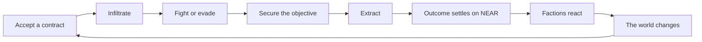
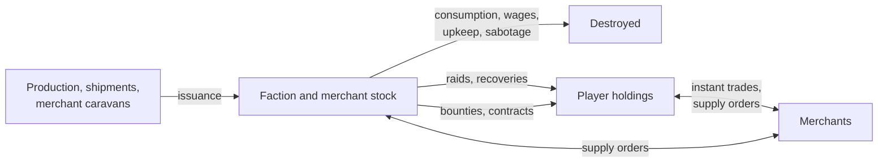
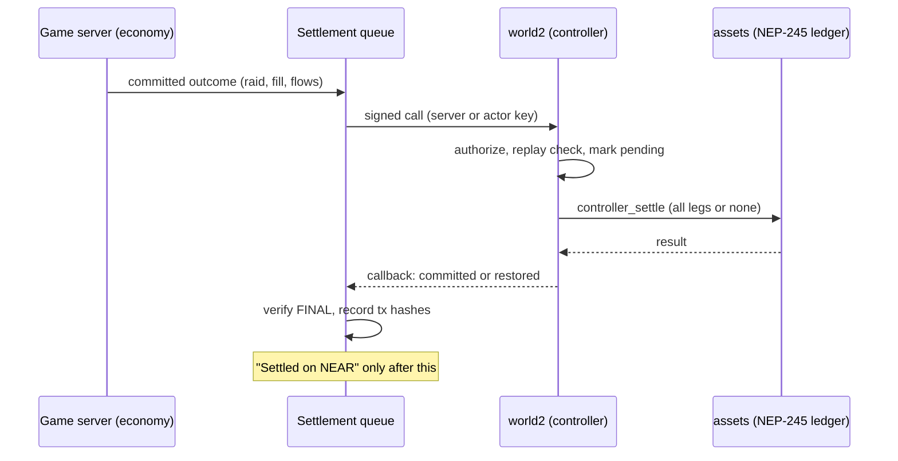
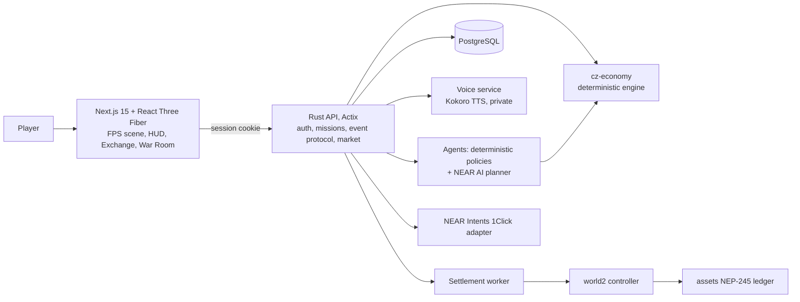

# CONTRACT ZERO

**A tactical extraction shooter whose missions come from a living economy: take a faction's supplies, and its next defenders feel it.**


CONTRACT ZERO is a first-person extraction shooter built on an autonomous economy.
- **Factions and merchants** hold real treasuries and stockpiles, recorded on NEAR.
- **Missions are generated from that economy**: what you raid, sabotage or recover changes what those actors hold, and what they can field next.
- **The actors react on their own**: they buy, sell, compete and retaliate.

Built for the **NEAR Hackathon (November 2026)**, track **Games With Real Economies**.

| | |
|---|---|
| **Play** | **<https://contract-zero.vercel.app>**: Training needs no account; contracts need a NEAR testnet wallet ("I already have a NEAR wallet"). Or run it locally ([Quickstart](#quickstart)) |
| **Learn to play** | [Player's Field Manual](docs/PLAYER_GUIDE.md) · [Controls](docs/CONTROLS.md) |
| **Watch** | [Demo script](docs/contract-zero/DEMO.md). The automated, recorded run of all 16 steps is reproducible with `apps/web/demo-run.mjs` ([last report](docs/contract-zero/demo/report-2026-11-09.json)). Radio voices, as heard in game: [docs/contract-zero/voice](docs/contract-zero/voice) |
| **Submission** | [SUBMISSION.md](docs/SUBMISSION.md): the one-page summary |
| **Verify on NEAR** | [`assets.contract-zero.testnet`](https://testnet.nearblocks.io/address/assets.contract-zero.testnet) (NEP-245 ledger) · [`world2.contract-zero.testnet`](https://testnet.nearblocks.io/address/world2.contract-zero.testnet) (game controller) · [evidence](docs/contract-zero/NEAR.md) |
| **Read the design** | [DESIGN.md](docs/contract-zero/DESIGN.md) · [Economy](docs/contract-zero/ECONOMY.md) · [Supply orders and NEAR Intents](docs/contract-zero/INTENTS.md) · [Missions](docs/contract-zero/MISSIONS.md) |

---

## The game in 30 seconds



1. **Pick a contract.** Raid a depot, sabotage a production line, or recover stolen cargo, at one of three sites: Dustline Depot, Blacksite or Cinder Yard. The time of day sets the conditions there.
2. **Fight in, take it, carry it out.** Cargo cases are physical: up to 3 at a time, and each slows you down. Only what you carry through a completed extraction counts.
3. **The faction really loses that stock.** Its commander notices within the hour. It may:
   - post a **supply order** that two merchants compete to fill;
   - change its guard;
   - pay to have a rival raided.

**Why the next mission differs.** A faction's ammunition decides how many guards it can arm, and with what. Its medicine decides reinforcements, and its fuel whether it can stage a depot at all. Your raid, the commander's response and the merchants' prices all feed into the next contract against it.


## Why CONTRACT ZERO is different

- **Missions come from a persistent economy.** The board is generated from what factions actually hold: depot size, guard count, weapons and bounties.
- **The actors are autonomous.** Two factions (Vanguard, the Ashen Compact) and two merchants (Vex Exchange, Halcyon Logistics) each have a treasury, an inventory and goals. They act every in-game hour, whether anyone is playing or not.
- **Supplies are combat capability.** Ammunition arms guards; medicine brings reinforcements; fuel stages depots. Shortages show up in the fight.
- **Actions have lasting consequences:**
  - a raid empties a depot;
  - sabotage stops a production line for 36 hours;
  - a recovery returns cargo to its owner.

  Merchants reprice, and commanders buy, wait or retaliate.
- **Assets are owned on NEAR.** Credits, ammunition, medicine, fuel and guns are NEP-245 tokens on NEAR testnet. Players hold them in their own accounts.
- **The blockchain is infrastructure.** Players sign in with Google or a wallet, play a shooter, and see "Settled on NEAR" once a result is confirmed. They never need to understand any of it to play.

**Deterministic rules, optional AI.**
- **The economy is a deterministic, integer-only engine**, conservation-checked so every unit is accounted for. Every agent decision is logged with its trigger, figures, action and rationale.
- **An optional LLM planner** on NEAR AI Cloud can propose strategy. Proposals pass the same policy checks and engine validation, and the planner never holds keys, moves balances or touches a gunfight.
- **The AI is currently off.** The project's NEAR AI account has no credits (every call returns 402), so the deterministic policies run everything.

## How to play

The full guide is the **[Player's Field Manual](docs/PLAYER_GUIDE.md)**. In game, the **How to play** button opens a short Field Manual; it's on the Hub, Training, contract intel, every briefing, Settings and the pause menu. The first time you fight, pick something up, carry cargo, extract or finish a contract, a one-line tip explains it.

1. **Open the game.** A welcome screen offers **Start training**: no account needed, unscored, never on chain.
2. **Practice:** Training → Practice → Dustline Depot, Day, Raid, L1. Learn to take a case and extract.
3. **Sign in** (Google, email or passkey via NEAR Auth, or a NEAR wallet) and pick a callsign.
4. **Contracts → View intel.** Review the site, objectives, resistance, reward and extraction. Then **Accept and get briefed**, **Choose loadout** and **Deploy**.
5. **Run the operation:**
   - **Raid:** take cargo cases.
   - **Sabotage:** plant two charges and get clear of the fuse.
   - **Recovery:** free the seized case and hand it over.

   Hold **E** on ammunition and medical cases, and on guards' dropped weapons and magazines.
6. **Extract.** Hold **E** in the zone, then stay inside for 8 seconds; leaving bleeds the countdown.
7. **See the result**, then **Settled on NEAR testnet** once the transaction confirms.
8. **Exchange.** Sell your haul to Vex, or post a supply order and accept the best offer.
9. **War Room.** Follow your raid into the faction's shortage, its supply order, the merchants' competing offers, the winner, every NEAR transaction, and the guard plan its next mission now faces.

| | Keyboard and mouse | Touch (landscape) |
|---|---|---|
| Move | **WASD** | Stick, bottom left |
| Look | Mouse (or the arrow keys) | Drag anywhere |
| Fire | Left mouse / **Space** | Fire pad, bottom right |
| Aim | Right mouse / **Shift** (hold) | **ADS** (toggle) |
| Use, interact | **E** (hold) | **USE** (hold) |
| Heal | **H** | **MED** |
| Reload / swap / fire mode | **R** / **X** (or 1, 2) / **B** | Right-edge column |
| Crouch / lean | **C** / **Q**, **G** | **CROUCH** (toggle) / none |
| Inspect / target lock | **I** / **T** | none / lock button |
| Night vision / light / laser / optic | **N** / **F** / **L** / **O** | Chips, top left |
| Pause | **Esc** | Top left |

Every key is rebindable (Settings → Key bindings). The complete list is generated from the game's own controls definition: [CONTROLS.md](docs/CONTROLS.md).

## Game modes and environments

| Mode | Scored | Settles on NEAR | What it is |
|---|---|---|---|
| **Live contracts** | ✓ | ✓ (testnet) | Raids, sabotage and recovery at real sites, generated by the economy. Each contract is bound to its site |
| **Practice** | — | — | Any site, hour, operation type, defence L1–L5 and cargo; the same objects and extraction as live |
| **Campaign** | — | — | 15 authored operations across Dustline, Redyard and the Blacksite |
| **Kill-House / Gauntlet** | — | — | Survival waves, from the campaign's operations board (M); the Gauntlet unlocks after the campaign |
| **Endless: No Exit** | — | — | Procedural rooms until you fall |
| **Seasonal Campaign** | | | **Not built** ([MISSIONS.md](docs/contract-zero/MISSIONS.md)) |

| Site | Map |
|---|---|
| **Dustline Depot** | Outdoor logistics yard: motor pool, container wall, warehouse |
| **Blacksite** | Fortified research facility: floodlit courtyard, labs, control room, vault |
| **Cinder Yard** | The Ashen Compact's refinery: tank farm, fractionation columns, loading bay, arms shed |

All three are distinct, playable maps for every operation type.

**The world clock runs one in-game hour per real minute.**
- **Day** (06:00–17:00): guards see 30 m.
- **Dusk** (17:00–21:00): 26 m, 92% accuracy, faster reinforcements.
- **Night** (21:00–06:00): 20 m, 80% accuracy, slower reinforcements, and night vision issued.

The hour changes the conditions, never the site.

## The autonomous economy

| Asset | Role |
|---|---|
| **Credits** | Currency: trades, wages, bounties, contract fees. Game currency, not NEAR |
| **Ammunition** | How many guards a faction arms, and with what |
| **Medicine** | Reinforcements during a fight |
| **Fuel** | Staging depots, running convoys |
| **Guns** | Owned equipment for your loadout |



**Issuance and destruction.** Every unit enters or leaves through one ledger (production, shipments, consumption, wages, upkeep, sabotage), and every asset sums to zero, so it can't leak.

**Merchant prices** follow each merchant's own stock against its target, plus a day of demand, within bounds.

**Shortages drive behaviour:**
- **Commanders** post bounded **supply orders**: a quantity, a price limit, an urgency and a deadline. Vex and Halcyon each price them from their own shelves, or decline with a reason. Commanders choose by doctrine: urgent orders favour coverage, routine ones price.
- **Merchants** sponsor raids on goods they're short of.
- **Ashen**, an aggressive faction, pays to have its rival raided first.

Detail: [ECONOMY.md](docs/contract-zero/ECONOMY.md), [INTENTS.md](docs/contract-zero/INTENTS.md).

## NEAR architecture



| Piece | What it does |
|---|---|
| [`cz-assets`](contracts-near/cz-assets) → `assets.contract-zero.testnet` | The NEP-245 multi-token ledger: balances, NEP-145 storage, per-epoch issuance budgets, an operation replay set. Only the controller can move actor balances, and a player's tokens move only when that player signs |
| [`cz-world-v2`](contracts-near/cz-world-v2) → `world2.contract-zero.testnet` | The game controller. It decides whether value may move: roles, raids, operations, merchant offers and bids, supply orders with escrow and on-chain proposals, quick-trade sessions with budgets and expiry, and replay protection |
| **Player identity** | NEAR Auth (Google, email or passkey) derives an account behind the scenes. NEAR wallets sign a NEP-413 challenge. The server never takes a supplied account id as proof ([AUTH.md](docs/contract-zero/AUTH.md)) |
| **Settlement** | A single-writer queue with leases, outcome classification (not sent, failed, unknown), idempotent retries checked against chain state, compensation and exact on-chain/off-chain reconciliation (`GET /reconciliation`) |
| **Agent guardrails** | Each actor signs with a function-call key restricted to `world2` and to its own methods. The contract enforces roles, limits and escrow, so no key, agent or LLM can mint, overspend or move a player's assets |
| **Supply orders** | Escrow-funded orders that registered merchants answer with on-chain proposals. The requester accepts one; the contract holds every fill to the order's price limit pro rata, and refunds unused escrow |
| **NEAR Intents (official)** | A separate **1Click** adapter: live asset discovery and live **dry** quotes on mainnet, with every protocol reference stored. Execution is gated (operator-only, explicit mainnet approval, a USD cap). **No mainnet swap has been executed yet**, and game assets aren't supported by NEAR Intents ([INTENTS.md](docs/contract-zero/INTENTS.md)) |

**Verified transactions:**
- **The acceptance run:** raid → shortage → autonomous purchase → NEAR → a changed next mission.
- **The Exchange run**, sabotage, the supply-order rollout, and a 29/29 supply-order E2E with every transaction hash.

All are in [NEAR.md](docs/contract-zero/NEAR.md) and [INTENTS.md](docs/contract-zero/INTENTS.md).

## Technical architecture



**The client and the server do different jobs:**
- **The client** (`apps/web`) runs the gunfight: deterministic combat AI, no LLM. It streams mission events.
- **The server** (`apps/api`) checks each run: timing, movement, reach and holds. Only the server turns an outcome into goods.
- **The server also writes the characters' radio dialogue:**
  - **Mission lines** (authored, or rewritten by NEAR AI and checked).
  - **Strategic radio:** lines built from its own records of faction decisions and merchant fills.
  - **Voicing:** each line is spoken by the private voice service (`apps/tts`, Kokoro-82M, Apache-2.0) and cached. Authored lines are pre-voiced.
  - **One source of truth:** the caption and the voice are always the same text, and there is never synthetic gibberish.
- **The browser reaches the API through the site's own `/api` route,** so the session cookie is first-party. Brave and Safari block third-party cookies.

```text
apps/web            Next.js 15, React Three Fiber: the game, the HUD, every page
  src/engine/fps      headless FPS sim, missions, field objects, levels
  src/engine/scene    the 3D scene (ContractZeroScene)
  src/lib             settings, key bindings, controls (one definition), auth, API client
apps/tts            the voice service: Kokoro TTS (Python), and pregen.py for authored lines
apps/api            Rust, Actix-web, PostgreSQL
  crates/economy      the deterministic world: ledger, pricing, missions, orders, agent policies
  src/                API, mission protocol, settlement worker, NEAR client, planner, 1Click adapter
  migrations/         embedded in the binary; applied on boot
contracts-near
  cz-assets           NEP-245 ledger
  cz-world-v2         game controller
  cz-world            v1 (frozen; kept for its verified history)
scripts/            end-to-end and on-chain verification scripts
docs/               player guide, controls, design, economy, NEAR evidence
```

## Quickstart

**Local development runs fully off-chain.** The economy, agents, missions, supply orders and developer sign-in all work, and nothing settles on NEAR. Testnet settlement needs the actor keys, which never live in the repository.

**Requires:** Node 22+, Rust (stable), PostgreSQL 15+. A development machine for this project ran PostgreSQL 14, which also works.

```bash
git clone https://github.com/Psalmuel01/contract-zero && cd contract-zero
npm install

# Database
createdb contract_zero

# API (Rust): migrates and seeds the world on first boot, listens on :8080
cd apps/api
cp .env.example .env          # off-chain by default; edit DATABASE_URL if needed
cargo run
# in another terminal:  curl localhost:8080/board

# Web: listens on :3000
cd ../web
cp .env.example .env.local    # NEXT_PUBLIC_API_URL=http://localhost:8080
npm run dev
```

Open <http://localhost:3000>. Training works without signing in. For live contracts, the sign-in page offers a **developer sign-in**, which works only while settlement is off.

**Testnet mode.** In `apps/api/.env`:
1. Uncomment the `CZ_*` block, and point `CZ_KEYS_DIR` at the actor key files (one per account, outside the repo).
2. Optionally set `CZ_RELAYER_*` for NEAR Auth sponsorship and quick trade.

The API then settles every outcome on `world2` and `assets`. [NEAR.md](docs/contract-zero/NEAR.md) covers the accounts and keys, and [DEPLOY.md](docs/contract-zero/DEPLOY.md) covers hosting (Supabase, Railway, Vercel).

**Contracts:**
```bash
cd contracts-near/cz-world-v2 && cargo test && RUSTUP_TOOLCHAIN=stable cargo near build non-reproducible-wasm
cd ../cz-assets               && cargo test && RUSTUP_TOOLCHAIN=stable cargo near build non-reproducible-wasm
```

## Testing and verification

| What | Command | Last result |
|---|---|---|
| Web unit tests, types | `cd apps/web && npx vitest run && npx tsc --noEmit -p .` | 946 tests pass |
| Economy and API | `cd apps/api && cargo test --workspace` (add `CZ_DB_TESTS=1` for the database tests) | all pass (API 64, economy 114) |
| API reliability: concurrent mission events, extraction and death; lock timeouts; dropped connections; NEAR RPC down | `node apps/api/scripts/reliability.mjs` against an off-chain API on a scratch database | all pass |
| Contracts | `cargo test` in `contracts-near/cz-assets` and `contracts-near/cz-world-v2` | 28 and 58 pass |
| Controls documentation in sync | part of the web tests (`controlsDoc.test.ts`) | passes |

These need a running API and web app:
| What | Command | Last result |
|---|---|---|
| Browser: accessibility | `node apps/web/probe-a11y.mjs` | WCAG 2.1 A/AA clean on every page and settings category |
| Every probe group: layout, standards, subtitles, presets, budgets, catwalk, War Table… | `node apps/web/probe-all.mjs` | 12/12 groups |
| The deployed site, desktop and phone | `node apps/web/probe-prod-smoke.mjs` | 52/52 |
| Radio voices: clean, combat, strategic, failed | `node apps/web/probe-voice-record.mjs` | recordings in [docs/contract-zero/voice](docs/contract-zero/voice) |
| Browser: settings, pause menu, market UI, help | `node apps/web/probe-config.mjs`, `probe-pause.mjs`, `probe-market.mjs`, `probe-docs.mjs` | 40/40, 9/9, 14/14, 19/19 |
| The recorded demo, all 16 steps | `node apps/web/demo-run.mjs` | 16/16, 0 page errors ([report](docs/contract-zero/demo/report-2026-11-09.json)) |

These need testnet settlement and the test player's key (maintainers):
| What | Command | Last result |
|---|---|---|
| Field integrity and settlement | `node scripts/field-e2e.mjs` | 24/24 |
| Supply orders on chain | `CZ_ADMIN_TOKEN=… node scripts/supply-e2e.mjs` | 29/29 ([evidence](docs/contract-zero/evidence/supply-e2e.json)) |
| Exchange, auth, acceptance | `scripts/exchange-e2e.mjs`, `auth-e2e.mjs`, `acceptance-e2e.mjs` | see NEAR.md and AUTH.md |

**Reproducing the core claim** (economy → autonomous decision → NEAR transaction → changed mission):
1. Run `scripts/supply-e2e.mjs`, or the recorded `demo-run.mjs`.
2. Check its transaction hashes on [nearblocks](https://testnet.nearblocks.io/address/world2.contract-zero.testnet).
3. Read the causal chain in the War Room ("Supply orders and competition").

## Status and limitations

| | Status |
|---|---|
| FPS: three site maps, three operation types, physical objects, cargo, extraction, guard weapon pickups, item inspection | **Implemented and verified** in the browser |
| Server-authoritative missions (event protocol, timing, movement and reach checks) | **Verified** (field E2E 24/24) |
| Economy, autonomous factions and merchants, supply orders with competing merchants | **Verified** (engine tests; live on testnet) |
| On-chain settlement, reconciliation, quick trade, wallet sign-in | **Verified on testnet** |
| Settings: graphics, audio, controls and key bindings, accessibility, account sync; Field Manual and first-time tips | **Verified** in the browser |
| Google, email or passkey sign-in (NEAR Auth) | **Built.** Works locally on `localhost:3000`; on the live site it needs this app's own NEAR Auth credentials (NEAR's shared test client accepts only localhost). Wallet sign-in works on the live site |
| NEAR Intents (official, 1Click) | **Read-only, verified** (live dry quotes). **Mainnet execution is prepared but not yet run** |
| NEAR AI strategic planner and mission dialogue | **Live.** Factions plan with NEAR AI when their situation materially changes, under a daily call cap. Mission dialogue is rewritten and checked line by line. The deterministic policies always run |
| Character voices | **Live.** Five distinct voices; authored lines pre-voiced; mission and strategic lines voiced by the server. A line without its voice in time is subtitle only |
| Public deployment | **Live:**<br>• **Web:** <https://contract-zero.vercel.app>, on Vercel.<br>• **API:** Railway, EU West.<br>• **Voice service:** Railway.<br>• **Database:** Supabase.<br>• **Settlement:** NEAR testnet.<br>See [DEPLOY.md](docs/contract-zero/DEPLOY.md) |
| Seasonal Campaign | **Planned** |

**Known limitations:**
- The 3D fight isn't usable with a screen reader; the rest of the UI is.
- Tested in Chrome, including the deployed site at phone size. Brave and Safari now get a first-party session cookie, but haven't been played through end to end.
- New voices take about 11 s to synthesize on the hosting CPU. Lines are voiced ahead of time where they can be known; one not ready in time plays as its subtitle.
- Order and proposal records stay on chain as replay protection and evidence. Mainnet would need a storage-deposit model ([INTENTS.md](docs/contract-zero/INTENTS.md)).

## Contributing and attribution

- **The FPS engine predates the hackathon.** It's the team's own earlier work, imported as the first commit and tagged [`pre-hackathon`](https://github.com/Psalmuel01/contract-zero/tree/pre-hackathon). Everything after that tag was built during the hackathon (`git diff pre-hackathon..HEAD`).
- **Licence:** MIT ([LICENSE](LICENSE)). Third-party assets and their licences: [apps/web/CREDITS.md](apps/web/CREDITS.md); the dependency audit: [LICENSING.md](docs/contract-zero/LICENSING.md).
- **To contribute:**
  1. Fork and branch from `main`, and keep each change focused.
  2. Run the tests above; for UI work, run the relevant probe.
  3. Never commit keys or `.env` files.
  4. If you change `levels.ts`, regenerate the server's layouts (`npx tsx scripts/export-layouts.ts` in `apps/web`). If you change controls or key bindings, regenerate [CONTROLS.md](docs/CONTROLS.md) (`npx tsx scripts/export-controls.ts`). Tests fail if either drifts.
- **Bugs:** open a [GitHub issue](https://github.com/Psalmuel01/contract-zero/issues) with what you did, what you expected, what happened, and your browser and device. For settlement problems, include the operation id or transaction hash from the results screen.
