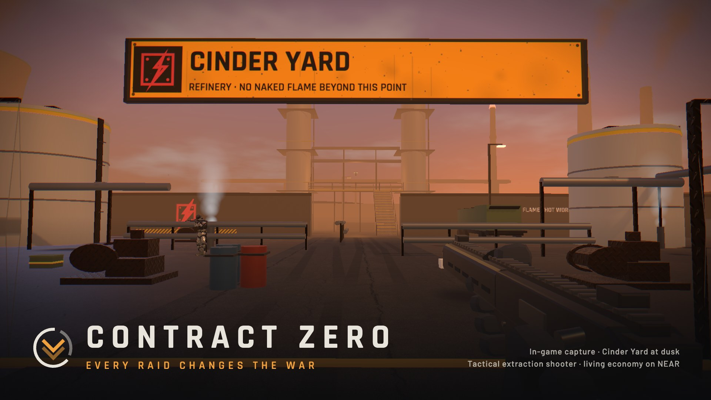
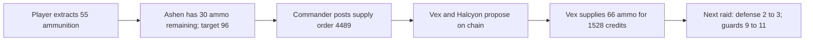
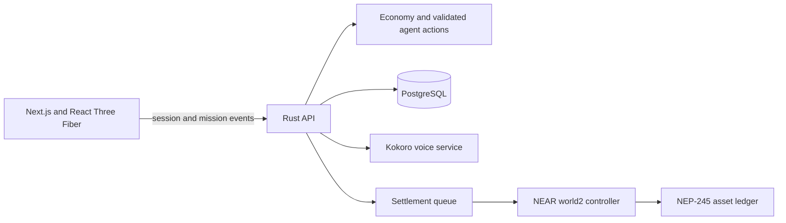

<div align="center">

[](https://contract-zero.vercel.app)

### A tactical extraction shooter where every raid changes the war.

**[▶ Play now](https://contract-zero.vercel.app)** · **[Watch demo video](https://youtu.be/UXW9PAMiNAA)** · **[Verify it on NEAR](#one-real-raid-end-to-end)** · **[Source](https://github.com/Psalmuel01/contract-zero)**

NEAR Hackathon, November 2026 · Track: **Games With Real Economies** · NEAR testnet

</div>


---

**CONTRACT ZERO is a first-person extraction shooter with a persistent economy.** Raid a faction's ammunition, and it has less to arm its guards. Its commander can order supplies, merchants compete to sell them, and the next mission reflects what happened. Assets and economic outcomes settle on NEAR testnet.

## Start playing

1. **[Open the game](https://contract-zero.vercel.app)** and choose **Start training**. No account is needed; training is unscored and stays off chain.
2. Start with **Training → Practice → Dustline Depot → Day → Raid → L1**.
3. For live contracts, **sign in and choose a callsign**, then open **Contracts → View intel → Accept → Choose loadout → Deploy**.
4. Take cargo, plant sabotage charges, or recover a seized case. Hold **E** to interact. For extraction, hold **E** in the zone and remain there for the eight-second countdown.
5. Read your results, then open the **War Room** to follow the faction's response and NEAR settlement.

**Essential controls:** WASD to move, mouse to look, left click to fire, right click to aim, **R** to reload, **H** to heal, **Esc** to pause. Touch controls are available in landscape.

[Player's Field Manual](docs/PLAYER_GUIDE.md) · [All controls](docs/CONTROLS.md)

Training is available immediately, without an account. See [sign-in availability](#status-and-limits) for the current live-contract login options.

## See the game

**[Watch the demo video](https://youtu.be/UXW9PAMiNAA)** to see the playable experience.

| | |
|---|---|
|  |  |
| **Cinder Yard:** tank farm, fractionation columns, and loading bay. | **Blacksite:** fortified courtyard, laboratories, and vault. |
|  |  |
| **War Room:** inspect supply orders, competing bids, and transactions. | **War Table:** locate contracts and inspect each site's readiness. |

Dustline Depot is an exposed military logistics compound; Blacksite is a fortified research facility; Cinder Yard is an operating refinery. All three support raids, sabotage, and recovery, with day, dusk, and night conditions.

## One real raid, end to end

A recorded run demonstrates the central claim:



The raid settled in [this transaction](https://testnet.nearblocks.io/txns/iRxHuNoY9h5wwRkX1TfyDHcNfjYSrxQN8KCoDaLzik7); the commander accepted Vex's proposal in [this transaction](https://testnet.nearblocks.io/txns/2C46ivpwHTB4SCdFNjG3ZoMrJTbLM3WJqUTUxsuW42rv). The recorded settlement-to-restock interval was **53 seconds**.

**These decisions came from deterministic policies.** This is evidence of the autonomous economy and settlement loop, not an AI-generated decision chain. [Every transaction, signer, and the stock-accounting caveat](docs/contract-zero/RAID_EVIDENCE.md).

### Why the economy changes the fight

| Resource or operation | Gameplay consequence |
|---|---|
| Ammunition | Determines how many guards the faction can arm and their weapons |
| Medicine | Determines reinforcements |
| Fuel | Supports depot staging and convoys |
| Raid | Transfers successfully extracted stock to the player |
| Sabotage | Destroys stock and stops production for 36 game hours |
| Recovery | Returns seized cargo to its owner |

Vanguard and the Ashen Compact hold their own treasuries and inventories. Vex Exchange and Halcyon Logistics compete from their own stockpiles. Commanders choose supply proposals by doctrine; merchants can sponsor attacks. Every asset movement is accounted for in an integer-only ledger, including issuance and destruction.

[Economy rules](docs/contract-zero/ECONOMY.md) · [Supply orders and NEAR Intents](docs/contract-zero/INTENTS.md) · [Mission design](docs/contract-zero/MISSIONS.md)

## What NEAR AI adds

NEAR AI Cloud adds strategic choices and character dialogue to the working economy:

- **Strategy:** an actor reviews its supplies, budget, threats, and memory, then proposes up to three moves. Event-driven reviews respond to completed operations and convoy seizures; periodic reviews consider materially changed situations, with cooldowns and a daily call cap.
- **A concrete example:** after an ammunition raid, Ashen could propose a supply order, a defense change, or a bounty against a rival. This is an illustrative choice, not a claim that the recorded raid above used AI. Accepted proposals enter the same economy and settlement path as other actions.
- **Dialogue:** mission briefing and radio text can be rewritten in character, checked line by line, then voiced by the separate Kokoro service. Authored text and subtitles remain available when generation or speech is unavailable.

**The model proposes; policy checks and the engine decide.** It cannot hold signing keys or bypass spending reserves, price limits, actor permissions, or engine validation. Combat uses deterministic simulation, not an LLM. Routine policies continue when the model fails or reaches its call cap.

The War Room distinguishes AI proposals from routine decisions, including rejected actions. The recorded on-chain example above proves the rule-based path; AI acceptance should be checked in its own decision records. [Implementation and production notes](docs/contract-zero/PRODUCTION.md).

## Architecture



The browser runs the fight. The API validates mission timing, movement, reach, and interactions before granting outcomes. PostgreSQL commits world changes with their records, and a settlement queue submits permitted operations to NEAR. **“Settled on NEAR” appears only after FINAL confirmation.**

- **Assets:** [`assets.contract-zero.testnet`](https://testnet.nearblocks.io/address/assets.contract-zero.testnet), a NEP-245 ledger.
- **Controller:** [`world2.contract-zero.testnet`](https://testnet.nearblocks.io/address/world2.contract-zero.testnet), enforcing roles, escrow, budgets, and replay protection.
- **Agent signing:** restricted function-call keys per faction and merchant. Players authorize their own asset movements through signed operations or scoped permissions.
- **NEAR Intents:** the separate 1Click adapter supports asset discovery and read-only mainnet quotes. Game assets are not routed through Intents; mainnet swap execution is gated and has not been run.

[NEAR architecture and evidence](docs/contract-zero/NEAR.md) · [Design](docs/contract-zero/DESIGN.md) · [Deployment](docs/contract-zero/DEPLOY.md)

## Run locally

Requires **Node 22+, stable Rust, and PostgreSQL 14+**. Default local development is off-chain; actor signing keys are needed only for testnet settlement and are never committed.

**One-time setup:**

```bash
git clone https://github.com/Psalmuel01/contract-zero
cd contract-zero
npm install
createdb contract_zero
cp apps/api/.env.example apps/api/.env
cp apps/web/.env.example apps/web/.env.local
```

Set `DATABASE_URL` in `apps/api/.env` to your local PostgreSQL connection. The API applies migrations and seeds a new world on first startup. The web example points to `http://localhost:8080`.

**Terminal 1 — API** (start from the repository root):

```bash
cd apps/api
cargo run
```

**Terminal 2 — web** (start from the repository root):

```bash
cd apps/web
npm run dev
```

Open **http://localhost:3000**. Training needs no sign-in. Developer sign-in is available only while testnet settlement is disabled. For voice-service setup, hosted environments, and testnet keys, follow [DEPLOY.md](docs/contract-zero/DEPLOY.md) and [AUTH.md](docs/contract-zero/AUTH.md).

## Verification

Run these from the repository root:

```bash
npm test
npm run typecheck
cargo test --manifest-path apps/api/Cargo.toml --workspace
cargo test --manifest-path contracts-near/cz-assets/Cargo.toml
cargo test --manifest-path contracts-near/cz-world-v2/Cargo.toml
```

**Dated evidence:** the [9 November 2026 demo report](docs/contract-zero/demo/report-2026-11-09.json) records all 16 steps with no page errors. The separate [supply-order evidence](docs/contract-zero/evidence/supply-e2e.json) records 29 passing checks and transaction hashes; its execution date is not recorded in the filename.

Browser, database, reliability, and live-chain checks have additional prerequisites. [Complete verification commands, recorded results, and their provenance](docs/contract-zero/VERIFICATION.md). Historical results do not establish the current state of the hosted service.

## Status and limits

| Area | Documented project status |
|---|---|
| Gameplay and economy | Three sites, three operation types, autonomous factions/merchants, and supply competition implemented |
| Hosting | Web on Vercel; API and voice on Railway; database on Supabase; assets settle on NEAR testnet |
| Sign-in | Email login through Privy is verified. NEAR testnet wallet login is also available. NEAR Auth social login on the deployed domain awaits dedicated credentials. [Details](docs/contract-zero/AUTH.md) |
| AI and voices | Strategic planning and mission dialogue integrated; call caps, validation, authored text, and subtitle fallbacks apply |
| Settlement | Queued; results remain pending until transactions are FINAL |
| Browser coverage | Chrome desktop and phone-sized browser checks recorded; physical-device coverage is not established by viewport emulation; Brave/Safari lack a full recorded play-through |
| Accessibility | Non-combat UI has accessibility checks; the 3D fight is not screen-reader accessible |
| Mainnet | Not launched. Persistent on-chain order records need a storage-deposit model before migration |
| Seasonal campaign | Planned, not built |

New voice lines can take about 11 seconds on the hosting CPU, so lines are prepared and cached where possible. See [voice notes](docs/contract-zero/voice/) and [performance notes](docs/contract-zero/PERFORMANCE.md) for measurement context.

## Contributing and attribution

The team's FPS engine predates this hackathon and is tagged [`pre-hackathon`](https://github.com/Psalmuel01/contract-zero/tree/pre-hackathon). The project attributes subsequent hackathon work through the Git history (`git diff pre-hackathon..HEAD`).

**MIT licensed.** [LICENSE](LICENSE) · [Asset credits](apps/web/CREDITS.md) · [Dependency audit](docs/contract-zero/LICENSING.md). The cover is an in-game capture.

Keep changes focused, run the relevant checks, and never commit keys or `.env` files. Changes to `levels.ts` require regenerating server layouts; control changes require regenerating [CONTROLS.md](docs/CONTROLS.md). Export commands are in the existing scripts under `apps/web/scripts/`.

[Report a bug](https://github.com/Psalmuel01/contract-zero/issues) with reproduction steps, browser/device, and—where relevant—the settlement operation ID or transaction hash.
