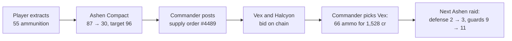
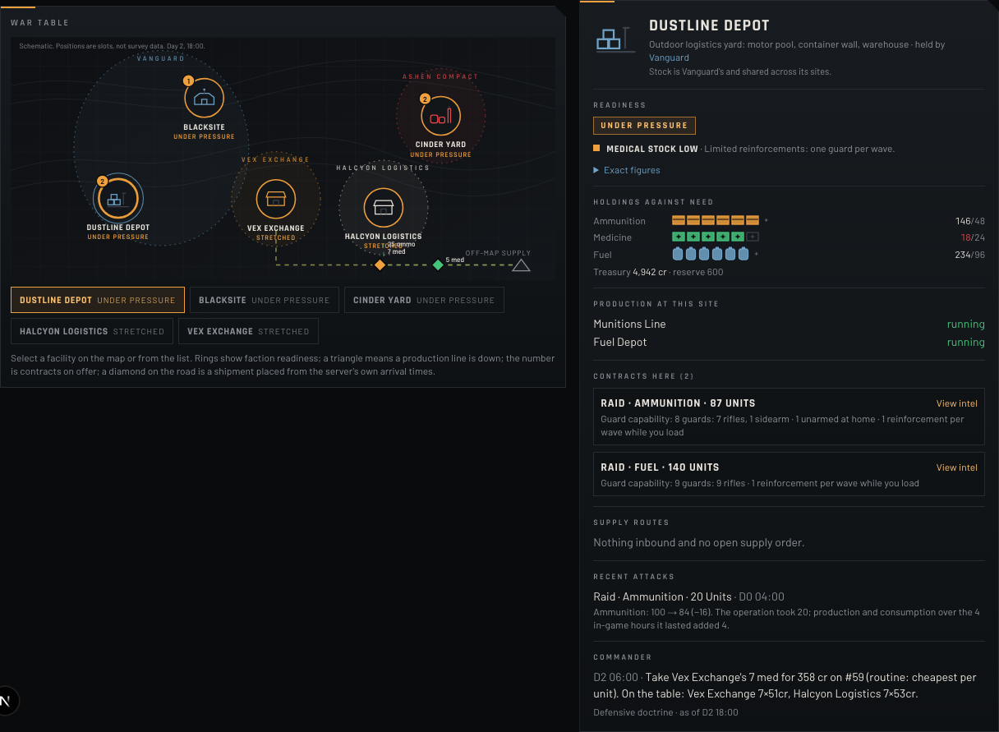
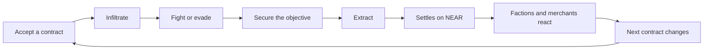
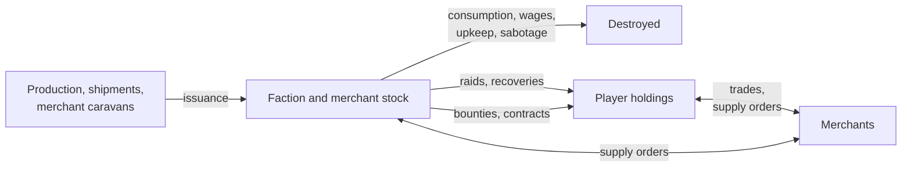
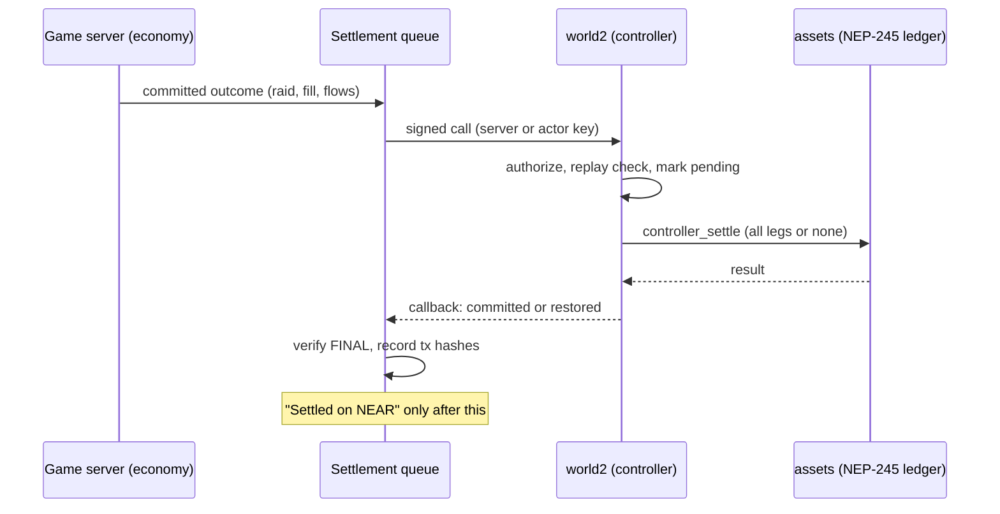
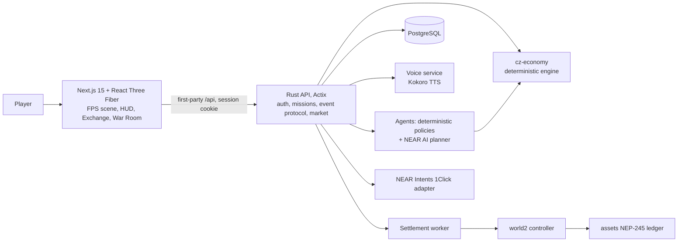

<div align="center">

[](https://contract-zero.vercel.app)

### A tactical extraction shooter where every raid changes the war.

**[▶ Play now](https://contract-zero.vercel.app)** · **[Watch the 60-second trailer](docs/media/contract-zero-trailer.mp4)** · **[Verify it on NEAR](#one-real-raid-end-to-end)** · **[Source](https://github.com/Psalmuel01/contract-zero)**

NEAR Hackathon, November 2026 · Track: **Games With Real Economies** · NEAR testnet

</div>

---

Most shooters reset after a fight. In CONTRACT ZERO the fight is where the consequences begin.

- **You raid real stockpiles.** Every contract targets what a faction actually holds. Take its ammunition and it really has less.
- **The world answers without you.** Two factions and two merchants run their own treasuries and inventories. When a commander runs short it posts a supply order, the merchants compete to fill it, and the trade settles on NEAR.
- **The battlefield follows the books.** Ammunition decides how many guards a faction can arm, medicine its reinforcements, fuel whether it can stage a depot. The next contract against it is different because the economy is.
- **The chain stays out of the way.** Assets are NEP-245 tokens on NEAR testnet in your own account, but you play a shooter, not a wallet.

## One real raid, end to end

Not a mock-up: one player raid on the live game (14 November 2026) and everything it set off, each step read back from NEAR testnet.



| Step | Transaction (NEAR testnet, FINAL) | Signed by |
|---|---|---|
| Raid settles: 55 ammunition to the player | [`iRxHuNoY…zik7`](https://testnet.nearblocks.io/txns/iRxHuNoY9h5wwRkX1TfyDHcNfjYSrxQN8KCoDaLzik7) · `settle_raid` | `server.contract-zero.testnet` |
| Ashen places supply order #4489 | [`3KT6DyfJ…Q6P1`](https://testnet.nearblocks.io/txns/3KT6DyfJnfHRjuouEHwSLxyPnDCAFfvTaPY2PniqQ6P1) · `place_order` | `ashen.contract-zero.testnet` |
| Halcyon offers 48 for 1,333 cr | [`BP5ohPHZ…a82B`](https://testnet.nearblocks.io/txns/BP5ohPHZKgy7xB7TvbGci4iJnPbkHvNKqs93raMga82B) · `propose` | `halcyon.contract-zero.testnet` |
| Vex offers 66 for 1,528 cr | [`DG2REwGB…Yifh`](https://testnet.nearblocks.io/txns/DG2REwGB9TzJmtv3SFGnD1SGfDJH6pNzwkVrmNRGYifh) · `propose` | `vex.contract-zero.testnet` |
| Commander accepts Vex ("urgent: most coverage first, then price") | [`2C46ivpw…42rv`](https://testnet.nearblocks.io/txns/2C46ivpwHTB4SCdFNjG3ZoMrJTbLM3WJqUTUxsuW42rv) · `accept_proposal` | `ashen.contract-zero.testnet` |

From the raid's settlement to the restock's fill: **53 seconds**. The decisions in this chain were made by the rule-based planner (the NEAR AI planner runs alongside it; see [AI](#ai-proposes-the-rules-decide)). More verified chains, including a 29/29 supply-order end-to-end run with every hash, are in [NEAR.md](docs/contract-zero/NEAR.md) and [supply-e2e.json](docs/contract-zero/evidence/supply-e2e.json). In the game, the **War Room** shows the same causal chain for any operation.

## See it

| | |
|---|---|
|  |  |
| **Cinder Yard.** The Ashen Compact's refinery: tank farm, fractionation columns, loading bay. | **Blacksite.** A fortified facility: floodlit courtyard, labs, control room, vault. |
|  |  |
| **War Room.** Your raid traced into the shortage, the order, both bids, the winner, every transaction and the next mission's guard plan. | **War Table.** Each site's holder, readiness, stock and the contracts open against it. |
|  |  |
| **Hub.** What changed since you were last here, and the next operation. | **Contracts.** Generated from the economy: cargo, guards, bounty and why. |

## The game



1. **Pick a contract.** Raid a depot, sabotage a production line or recover stolen cargo, at Dustline Depot, Blacksite or Cinder Yard. The hour sets the conditions.
2. **Fight in, take it, carry it out.** Cargo cases are physical: up to 3, each one slows you. Only what you carry through a completed extraction counts.
3. **Watch the world answer.** The faction really loses that stock. Its commander may post a supply order, change its guard or pay to have a rival raided.

| Operation | Objective | What it does to the world |
|---|---|---|
| **Raid** | Take the cargo cases and extract | The target loses that stock; you gain it on NEAR |
| **Sabotage** | Plant two charges, clear the fuse | Destroys stock; the line stops producing for 36 game hours |
| **Recovery** | Free the seized case and hand it over | Returns stolen goods to their owner |

| Site | Map |
|---|---|
| **Dustline Depot** | Outdoor logistics yard: motor pool, container wall, warehouse |
| **Blacksite** | Fortified research facility: floodlit courtyard, labs, control room, vault |
| **Cinder Yard** | Refinery: tank farm, fractionation columns, loading bay, arms shed |

**The world clock runs one in-game hour per real minute.** Day (06:00–17:00): guards see 30 m. Dusk (17:00–21:00): 26 m, 92% accuracy, faster reinforcements. Night (21:00–06:00): 20 m, 80% accuracy, slower reinforcements, night vision issued. The hour changes the conditions, never the site.

### How to play

The full guide is the **[Player's Field Manual](docs/PLAYER_GUIDE.md)**; in game, **How to play** opens it from the Hub, Training, every briefing, Settings and the pause menu.

1. **Open the game** and choose **Start training**: no account, unscored, never on chain. Training → Practice → Dustline Depot, Day, Raid, L1 is the gentlest start.
2. **Sign in with a NEAR testnet wallet** for live contracts (see [sign-in status](#status-and-limitations)) and pick a callsign.
3. **Contracts → View intel → Accept → Choose loadout → Deploy.**
4. **Extract:** hold **E** in the zone, then stay inside for 8 seconds; leaving bleeds the countdown.
5. **Follow it:** the result screen shows **Settled on NEAR testnet** once the transaction confirms; the **War Room** shows what your raid caused.

| | Keyboard and mouse | Touch (landscape) |
|---|---|---|
| Move / look | **WASD** / mouse (or arrows) | Stick bottom left / drag anywhere |
| Fire / aim | Left mouse or **Space** / right mouse or **Shift** | Fire pad / **ADS** (toggle) |
| Use, interact | **E** (hold) | **USE** (hold) |
| Heal / reload / swap | **H** / **R** / **X** (or 1, 2) | **MED** / right-edge column |
| Crouch / lean | **C** / **Q**, **G** | **CROUCH** (toggle) |
| Night vision / light / laser / optic | **N** / **F** / **L** / **O** | Chips, top left |
| Full screen / pause | **V** / **Esc** | Settings, or add to Home Screen / top left |

Every key is rebindable (Settings → Key bindings); the complete list is generated from the game's own controls definition: [CONTROLS.md](docs/CONTROLS.md).

| Mode | Scored | Settles on NEAR | What it is |
|---|---|---|---|
| **Live contracts** | ✓ | ✓ (testnet) | Raids, sabotage and recovery at real sites, generated by the economy |
| **Practice** | | | Any site, hour, operation and defence level; the same objects and extraction as live |
| **Campaign** | | | 15 authored operations across Dustline, Redyard and the Blacksite |
| **Kill-House / Gauntlet** | | | Survival waves; the Gauntlet unlocks after the campaign |
| **Endless: No Exit** | | | Procedural rooms until you fall |

## The autonomous economy

| Asset | What it does |
|---|---|
| **Credits** | Game currency (not NEAR): trades, wages, bounties, contract fees |
| **Ammunition** | How many guards a faction arms, and with what |
| **Medicine** | Reinforcements during a fight |
| **Fuel** | Staging depots and running convoys |
| **Guns** | Owned equipment for your loadout |



- **Conserved.** Every unit enters or leaves through one ledger, and every asset sums to zero: nothing leaks or appears. The engine is deterministic and integer-only.
- **Priced by stock.** Each merchant prices from its own shelf against its target, plus a day of demand, within bounds.
- **Driven by shortage.** Commanders post bounded supply orders (quantity, price limit, urgency, deadline); Vex and Halcyon each bid from their own shelves or decline with a reason; the commander chooses by doctrine. Merchants also sponsor raids on goods they're short of, and the aggressive Ashen Compact pays to have its rival hit first.
- **Logged.** Every decision is recorded with its trigger, the figures it saw, the action and the reason.

Detail: [ECONOMY.md](docs/contract-zero/ECONOMY.md) · [INTENTS.md](docs/contract-zero/INTENTS.md) · [DESIGN.md](docs/contract-zero/DESIGN.md) · [MISSIONS.md](docs/contract-zero/MISSIONS.md)

### AI proposes, the rules decide

- **Two planning layers.** Deterministic policies run every faction and merchant every game hour, always. On top, a **NEAR AI Cloud** planner (currently `anthropic/claude-haiku-5-5`) proposes strategy when an actor's situation materially changes, under a daily call cap.
- **The model has no authority.** Each proposal is parsed into a typed action and checked against the actor's policy (only its own kind of moves, spending above its reserve, price discipline), then executed by the engine like any other command. It never holds keys, moves balances or touches a gunfight. A rejected proposal changes nothing and is logged as `rejected_by_policy`.
- **It also writes dialogue.** Mission radio lines are rewritten by NEAR AI and checked line by line; authored lines are the fallback.

## NEAR architecture



| Piece | What it does |
|---|---|
| [`cz-assets`](contracts-near/cz-assets) → [`assets.contract-zero.testnet`](https://testnet.nearblocks.io/address/assets.contract-zero.testnet) | The NEP-245 multi-token ledger: balances, NEP-145 storage, per-epoch issuance budgets, an operation replay set. Only the controller moves actor balances; a player's tokens move only when that player signs |
| [`cz-world-v2`](contracts-near/cz-world-v2) → [`world2.contract-zero.testnet`](https://testnet.nearblocks.io/address/world2.contract-zero.testnet) | The game controller: roles, raids, operations, merchant offers and bids, escrowed supply orders with on-chain proposals, quick-trade sessions with budgets and expiry, replay protection |
| **Agent guardrails** | Each faction and merchant signs with its own function-call key, restricted to `world2` and its own methods. The contract enforces roles, limits and escrow, so no key, agent or model can mint, overspend or move a player's assets |
| **Settlement** | A single-writer queue with leases, outcome classification (not sent, failed, unknown), idempotent retries checked against chain state, compensation, and on-chain/off-chain reconciliation (`GET /reconciliation`). The game says "Settled on NEAR" only after a transaction is FINAL |
| **Player identity** | NEAR wallets sign a NEP-413 challenge. The server never accepts a supplied account id as proof ([AUTH.md](docs/contract-zero/AUTH.md)) |
| **NEAR Intents (official 1Click)** | A separate adapter: live asset discovery and **read-only dry quotes on mainnet**. Execution is built but gated (operator-only, explicit mainnet approval, a USD cap) and **has never been run**; game assets aren't routed through Intents ([INTENTS.md](docs/contract-zero/INTENTS.md)) |

## Technical architecture



- **The client runs the gunfight; the server decides what it was worth.** The browser runs combat (deterministic AI, no LLM) and streams mission events; the API checks timing, movement, reach and holds, and only the server turns an outcome into goods.
- **The server writes the radio.** Mission lines and strategic radio (built from the server's own records of decisions and fills) are voiced by a private Kokoro-82M service (Apache-2.0) and cached; the caption and the voice are always the same text.
- **Persistence.** The world is snapshotted in the same PostgreSQL transaction as every change it commits, with its ledger appended separately so a snapshot stays small; a world with a damaged ledger refuses to start.

```text
apps/web            Next.js 15 + React Three Fiber: the game, the HUD, every page
  src/engine/fps      headless FPS sim, missions, field objects, levels
  src/engine/scene    the 3D scene
  src/lib             settings, key bindings, controls, auth, API client
apps/api            Rust, Actix-web, PostgreSQL
  crates/economy      the deterministic world: ledger, pricing, missions, orders, agent policies
  src/                API, mission protocol, settlement worker, NEAR client, planner, 1Click adapter
  migrations/         embedded in the binary; applied on boot
apps/tts            the voice service (Kokoro TTS) and pregen.py for authored lines
contracts-near
  cz-assets           NEP-245 ledger
  cz-world-v2         game controller
  cz-world            v1 (frozen; kept for its verified history)
scripts/            end-to-end and on-chain verification
docs/               player guide, controls, design, economy, NEAR evidence
```

## Quickstart

**Local development runs fully off-chain**: the economy, agents, missions, supply orders and a developer sign-in all work, and nothing settles on NEAR. Testnet settlement needs the actor keys, which never live in the repository.

**Requires** Node 22+, Rust (stable), PostgreSQL 14+.

```bash
git clone https://github.com/Psalmuel01/contract-zero && cd contract-zero
npm install
createdb contract_zero

# API: migrates and seeds the world on first boot, listens on :8080
cd apps/api && cp .env.example .env && cargo run
# in another terminal:  curl localhost:8080/board

# Web: listens on :3000
cd apps/web && cp .env.example .env.local && npm run dev
```

Open <http://localhost:3000>. Training works without signing in; for live contracts the sign-in page offers a **developer sign-in**, available only while settlement is off.

**Testnet mode:** in `apps/api/.env`, uncomment the `CZ_*` block and point `CZ_KEYS_DIR` at the actor key files (outside the repo); optionally set `CZ_RELAYER_*` for sponsored accounts and quick trade. Accounts and keys: [NEAR.md](docs/contract-zero/NEAR.md). Hosting (Vercel, Railway, Supabase): [DEPLOY.md](docs/contract-zero/DEPLOY.md).

**Contracts:**
```bash
cd contracts-near/cz-world-v2 && cargo test && RUSTUP_TOOLCHAIN=stable cargo near build non-reproducible-wasm
cd ../cz-assets               && cargo test && RUSTUP_TOOLCHAIN=stable cargo near build non-reproducible-wasm
```

## Testing and verification

| What | Command | Last result |
|---|---|---|
| Web unit tests and types | `cd apps/web && npx vitest run && npx tsc --noEmit -p .` | 946 pass |
| Economy and API | `cd apps/api && cargo test --workspace` (add `CZ_DB_TESTS=1` for the database tests) | 114 economy, 65 API |
| Contracts | `cargo test` in `contracts-near/cz-assets` and `cz-world-v2` | 28 and 58 |
| API reliability: concurrent mission events, extraction and death, lock timeouts, dropped connections, NEAR RPC down | `node apps/api/scripts/reliability.mjs` (off-chain API, scratch database) | all pass |
| Accessibility | `node apps/web/probe-a11y.mjs` | WCAG 2.1 A/AA clean on every page |
| Every browser probe group | `node apps/web/probe-all.mjs` | 12/12 |
| The deployed site, desktop and phone | `node apps/web/probe-prod-smoke.mjs` | 52/52 |
| The recorded 16-step demo | `node apps/web/demo-run.mjs` | 16/16, 0 page errors ([report](docs/contract-zero/demo/report-2026-11-09.json)) |
| Field integrity and settlement (testnet, maintainers) | `node scripts/field-e2e.mjs` | 24/24 |
| Supply orders on chain (testnet, maintainers) | `CZ_ADMIN_TOKEN=… node scripts/supply-e2e.mjs` | 29/29 ([evidence](docs/contract-zero/evidence/supply-e2e.json)) |

**Reproduce the core claim** (raid → shortage → autonomous order → NEAR → changed mission): run `scripts/supply-e2e.mjs` or `demo-run.mjs`, check its hashes on [nearblocks](https://testnet.nearblocks.io/address/world2.contract-zero.testnet), and follow the chain in the War Room ("Supply orders and competition"). Demo walkthrough: [DEMO.md](docs/contract-zero/DEMO.md). Radio voices as heard in game: [docs/contract-zero/voice](docs/contract-zero/voice).

## Status and limitations

| | Status |
|---|---|
| FPS: three sites, three operation types, physical cargo, extraction, guard weapon pickups | **Working**, verified in the browser |
| Server-authoritative missions (event protocol, timing, movement and reach checks) | **Working** (field E2E 24/24) |
| Autonomous factions and merchants, competing supply orders | **Working**, live on testnet |
| On-chain settlement, reconciliation, quick trade | **Working** on testnet. Settlement is queued: under load the queue can run behind, and a result shows as pending until its transaction is FINAL |
| NEAR wallet sign-in | **Working** on the live site |
| Google, email or passkey sign-in (NEAR Auth) | **Built, not live.** Works on `localhost:3000`; the live site needs this app's own NEAR Auth credentials (NEAR's shared test client accepts only localhost) |
| NEAR AI planner and mission dialogue | **Live**, under a daily call cap; deterministic policies always run |
| Character voices | **Live**: five voices; a line not voiced in time plays as its subtitle |
| NEAR Intents (1Click) | **Read-only** (live dry quotes on mainnet). Execution built and gated, **never run** |
| Public deployment | **Live**: web on Vercel, API and voice on Railway, database on Supabase, settlement on NEAR testnet ([DEPLOY.md](docs/contract-zero/DEPLOY.md)) |
| Seasonal Campaign | **Planned**, not built |

**Known limitations**
- The 3D fight isn't usable with a screen reader; the rest of the UI is.
- Played end to end in Chrome (desktop and phone size). Brave and Safari get a first-party session but haven't had a full play-through.
- New voice lines take about 11 s to synthesize on the hosting CPU; lines are voiced ahead where possible.
- Order and proposal records stay on chain as replay protection; mainnet would need a storage-deposit model ([INTENTS.md](docs/contract-zero/INTENTS.md)).

## Contributing and attribution

- **The FPS engine predates the hackathon.** It's the team's own earlier work, imported as the first commit and tagged [`pre-hackathon`](https://github.com/Psalmuel01/contract-zero/tree/pre-hackathon); everything after it was built during the hackathon (`git diff pre-hackathon..HEAD`).
- **Licence:** MIT ([LICENSE](LICENSE)). Third-party assets and licences: [apps/web/CREDITS.md](apps/web/CREDITS.md); dependency audit: [LICENSING.md](docs/contract-zero/LICENSING.md). The cover is an in-game capture; the trailer is a cut of a recorded live raid with an original score and Kokoro narration.
- **To contribute:** branch from `main`, keep changes focused, run the tests above (and the relevant probe for UI work), and never commit keys or `.env` files. If you change `levels.ts`, regenerate the server's layouts (`npx tsx scripts/export-layouts.ts` in `apps/web`); if you change controls, regenerate [CONTROLS.md](docs/CONTROLS.md) (`npx tsx scripts/export-controls.ts`). Tests fail if either drifts.
- **Bugs:** open a [GitHub issue](https://github.com/Psalmuel01/contract-zero/issues) with what you did, expected and saw, plus your browser and device; for settlement problems include the operation id or transaction hash from the results screen.
