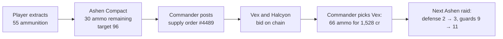

# One real raid, end to end

One player raid on the live game and everything it set off, each step read back from NEAR testnet.

| Step | Transaction (NEAR testnet, FINAL) | Signed by |
|---|---|---|
| Raid settles: 55 ammunition to the player | [`iRxHuNoY…zik7`](https://testnet.nearblocks.io/txns/iRxHuNoY9h5wwRkX1TfyDHcNfjYSrxQN8KCoDaLzik7) · `settle_raid` | `server.contract-zero.testnet` |
| Ashen places supply order #4489 | [`3KT6DyfJ…Q6P1`](https://testnet.nearblocks.io/txns/3KT6DyfJnfHRjuouEHwSLxyPnDCAFfvTaPY2PniqQ6P1) · `place_order` | `ashen.contract-zero.testnet` |
| Halcyon offers 48 for 1,333 cr | [`BP5ohPHZ…a82B`](https://testnet.nearblocks.io/txns/BP5ohPHZKgy7xB7TvbGci4iJnPbkHvNKqs93raMga82B) · `propose` | `halcyon.contract-zero.testnet` |
| Vex offers 66 for 1,528 cr | [`DG2REwGB…Yifh`](https://testnet.nearblocks.io/txns/DG2REwGB9TzJmtv3SFGnD1SGfDJH6pNzwkVrmNRGYifh) · `propose` | `vex.contract-zero.testnet` |
| Commander accepts Vex ("urgent: most coverage first, then price") | [`2C46ivpw…42rv`](https://testnet.nearblocks.io/txns/2C46ivpwHTB4SCdFNjG3ZoMrJTbLM3WJqUTUxsuW42rv) · `accept_proposal` | `ashen.contract-zero.testnet` |

From the raid's settlement to the restock's fill: **53 seconds**. The decisions in this chain were made by the rule-based planner (the NEAR AI planner runs alongside it; see [AI planning](../../README.md#what-near-ai-adds)). More verified chains, including a 29/29 supply-order end-to-end run with every hash, are in [NEAR.md](NEAR.md) and [supply-e2e.json](evidence/supply-e2e.json). In the game, the **War Room** shows the same causal chain for any operation.

The earlier README showed stock moving from 87 to 30 during the observed interval.
That is a 57-unit change, while the player extracted 55. The evidence presented here
does not attribute the other two units to a particular cause; the diagram therefore
shows the resulting shortage rather than treating the full stock delta as raid loot.
