# Before and after

Every pair is the same frame in both builds: the previous commit (`92be973`) on the left,
this pass on the right. Each pair shares the seed, camera position, hour and quality (High), at 1280×720.
They were rendered on this machine's GPU by `apps/web/probe-vistas.mjs` and `probe-viewmodel.mjs`.
These are fixed viewpoints, not picked frames. The full matched set covers 3 sites × 3 hours × 5 views and is
regenerated with:

```sh
GPU=1 node apps/web/probe-vistas.mjs <dir> dustline-depot,blacksite,cinder-yard day,dusk,night
GPU=1 BASE=http://localhost:<port of the other build> node apps/web/probe-vistas.mjs <dir2> ...
```

## The weapon

On the bench (side view, hands on): the old rifle and the new service carbine.

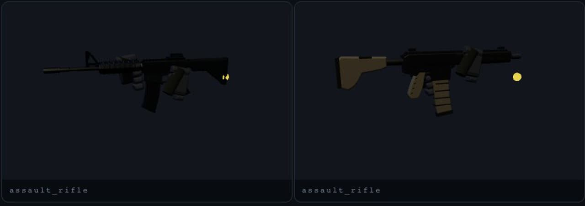

Each row is one state, before on the left and after on the right:
1. **At the hip.**
2. **Aimed.** Shouldered on the centre line now; before, it sat to the side and you looked at its flank.
3. **Nose against a wall.** It lowers instead of clipping.

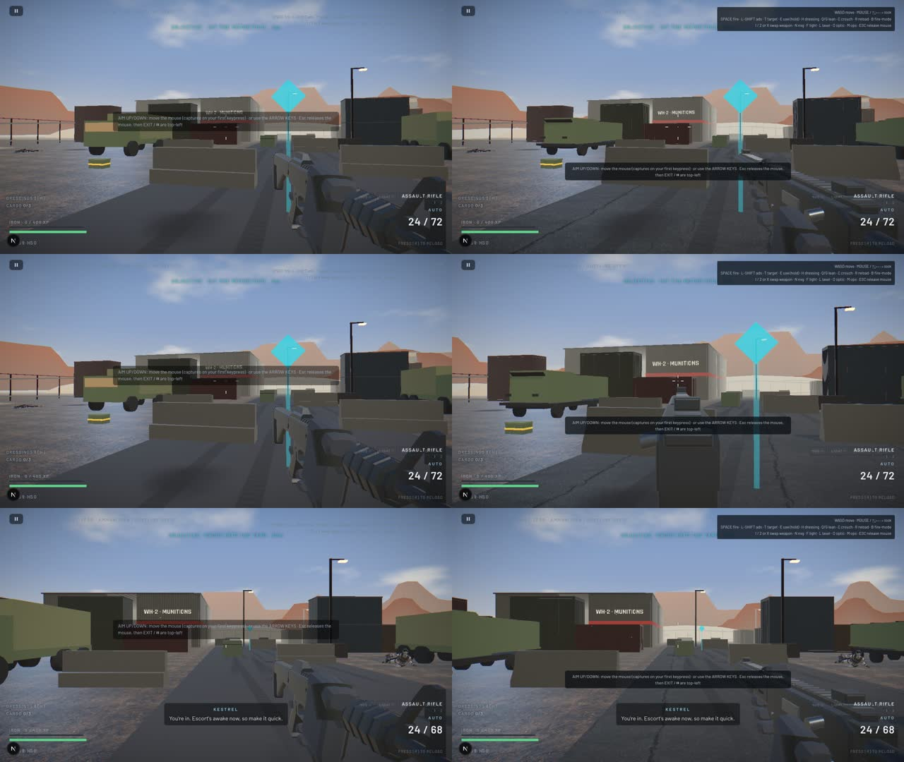

Low quality (top) and a phone with touch controls (bottom):

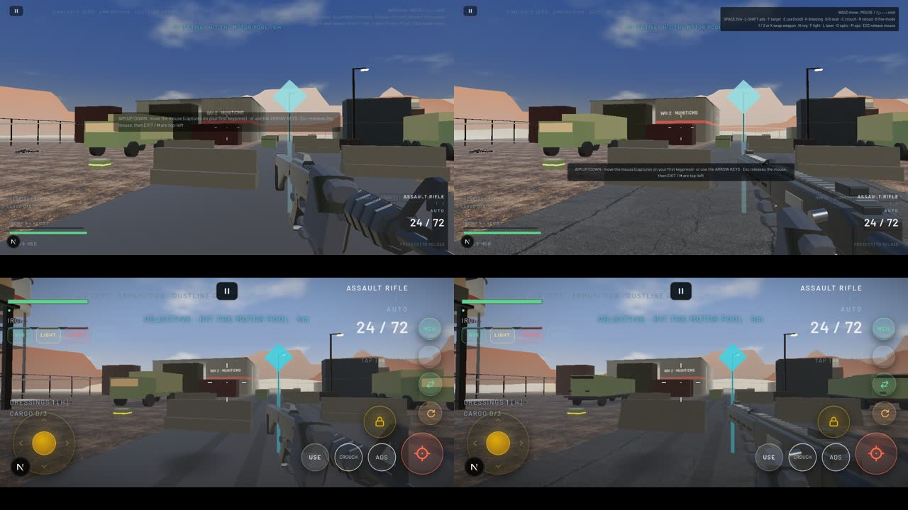

## Dustline Depot: the exposed logistics compound

Each pair shows the following.
- **Day, at the start:** asphalt where there was a dark slab, and concrete barriers where the staged attempt had white blocks.
- **Dusk, the push.**
- **Night, looking back at the south gate:** the ground runs on to the hills instead of a pale band.

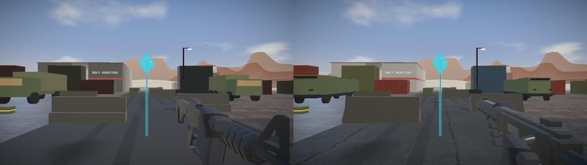
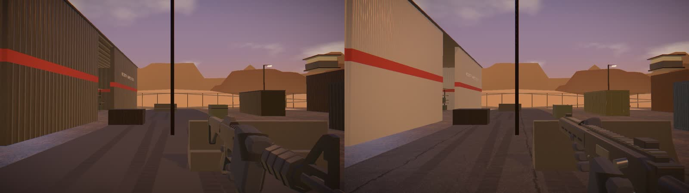
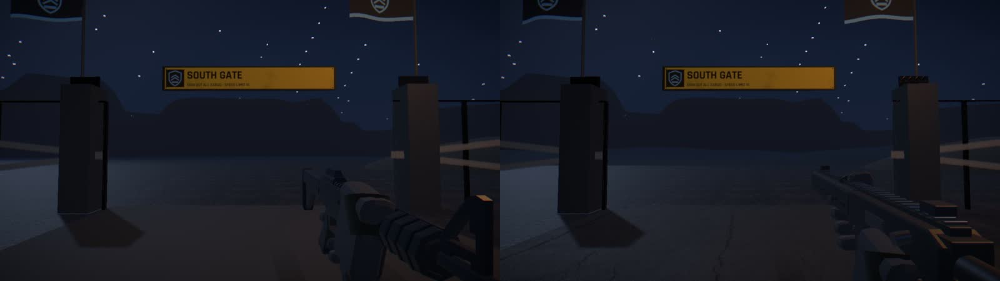

The ground underfoot:

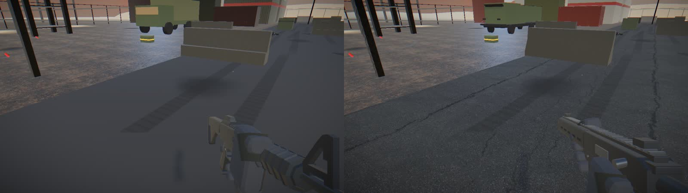

## Blacksite: the fortified research facility

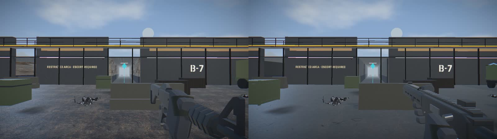
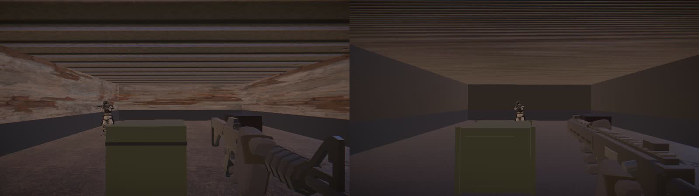
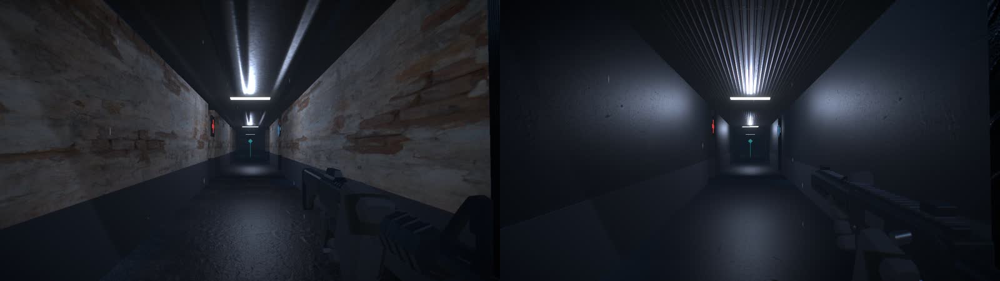

## Cinder Yard: the operating refinery

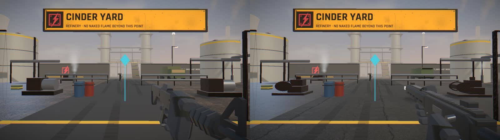
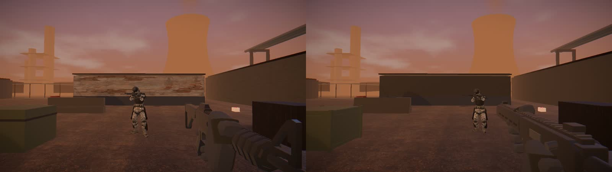
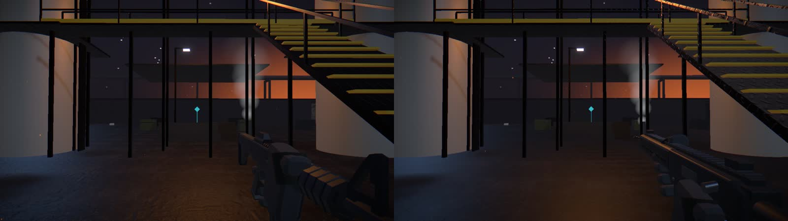

## What the pairs show, honestly

- **The clearest gains:**
  - the weapon, held and aimed like a real one;
  - the roads;
  - no white or camouflaged surfaces;
  - props that share their site's materials.
- **The architecture is the same boxes.** Blacksite's hall is a bare concrete room in both builds.
- **The night shots are dark in both builds.** The hour's lighting was not re-art-directed.

See [REPORT.md](REPORT.md) for the measurements and the limits.
